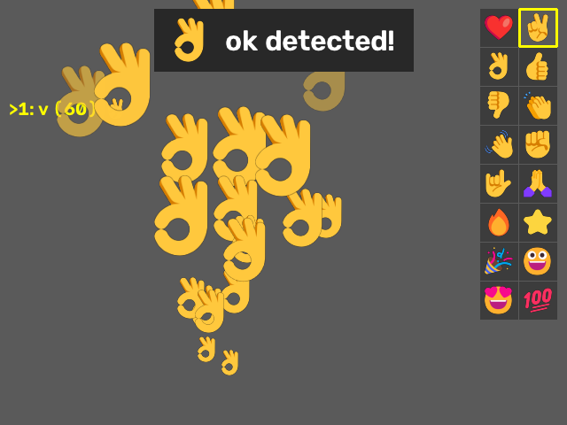

# mediapipe-hand

[MediaPipe Tasks](https://ai.google.dev/edge/mediapipe/solutions/guide)로 웹캠 손·얼굴을 실시간 인식하고, **내가 만든 제스처를 직접 학습**시켜 인식하면 **이모지가 날아가는** 프로젝트입니다.

- **🌐 웹 데모:** https://steve5781-a11y.github.io/mediapipe-hand/ — 설치 없이 브라우저에서 바로 실행
- **기본 데모:** Hand Landmarker / Gesture Recognizer / Face Landmarker
- **커스텀 제스처:** 손 모양 녹화 → 학습 → 실시간 인식
- **이모지 효과:** 제스처마다 이모지 연결 → 인식되면 `✌️ v detected!` 표시 + 손에서 이모지가 날아감

<p align="center"></p>

## 목차

1. [웹 데모 (GitHub Pages)](#1-웹-데모-github-pages)
2. [설치](#2-설치)
3. [파일 구성](#3-파일-구성)
4. [기본 데모](#4-기본-데모)
5. [커스텀 제스처 학습](#5-커스텀-제스처-학습) ⭐
6. [이모지 효과](#6-이모지-효과)
7. [간단 버전: 학습 없이 바로 인식](#7-간단-버전-학습-없이-바로-인식)
8. [📚 오늘 배운 것 정리](#8--오늘-배운-것-정리) ⭐
9. [참고 자료](#9-참고-자료)
10. [문제 해결](#10-문제-해결)

---

## 1. 웹 데모 (GitHub Pages)

**https://steve5781-a11y.github.io/mediapipe-hand/**

`📷 카메라 시작`을 누르고 권한을 허용하면 학습한 제스처(❤️ heart, 👌 ok, ✊ rock, ✌️ v)를 인식합니다.
오른쪽 패널에 제스처 목록과 확률이 보이고, 인식되면 초록색으로 표시되며 손에서 이모지가 날아갑니다.
영상은 브라우저 안에서만 처리되고 서버로 전송되지 않습니다.

- 손 인식: MediaPipe Tasks Vision **JS** (`@mediapipe/tasks-vision@1.1.0`, Python과 같은 버전)
- 제스처 분류: Python에서 학습한 모델을 `export_web_model.py`로 `docs/gesture_model.json`에 변환해 브라우저에서 직접 계산
- 페이지 소스: [`docs/index.html`](docs/index.html) — `main` 브랜치의 `docs/` 폴더가 그대로 배포됩니다

**내 제스처로 웹 데모 바꾸기** (수집 → 학습 후):

```bash
python export_web_model.py   # docs/gesture_model.json 갱신 (PyTorch와 예측이 같은지 자동 검증)
git add docs/gesture_model.json && git commit -m "Update web model" && git push
```

푸시하고 1~2분 뒤 웹 페이지에 반영됩니다.

## 2. 설치

```bash
git clone https://github.com/steve5781-a11y/mediapipe-hand.git
cd mediapipe-hand
pip install -U -r requirements.txt
```

| 패키지 | 용도 |
| --- | --- |
| `mediapipe` | 손·얼굴 랜드마크, 제스처 인식 |
| `opencv-python` | 웹캠 입력, 화면 표시 |
| `numpy` | 좌표 계산 |
| `torch` | 커스텀 제스처 분류 모델 학습/추론 |
| `Pillow` | 이모지 그리기 (`cv2.putText`는 이모지를 못 그림) |

테스트 환경: Windows 11, Python 3.14, mediapipe 1.1.0, OpenCV 5.0, PyTorch 2.14

## 3. 파일 구성

| 분류 | 파일 | 설명 |
| --- | --- | --- |
| 기본 데모 | `hand_webcam.py` `gesture_webcam.py` `hand_gesture_webcam.py` `face_webcam.py` `all_webcam.py` | MediaPipe 기본 모델 데모 |
| 커스텀 제스처 | `collect_gestures.py` | ① 녹화 + 이모지 연결 → `gesture_data.csv`, `gesture_emojis.json` |
| | `train_gestures.py` | ② 학습 → `gesture_model.pt` |
| | `custom_gesture_webcam.py` | ③ 실시간 인식 + 제스처 패널 + 이모지 효과 |
| | `export_web_model.py` | ④ 웹용 모델 변환 → `docs/gesture_model.json` |
| | `emoji_effect.py` | 이모지 그리기 / 날아가는 효과 (①③ 공용) |
| 간단 버전 | `my_gesture.py` | 수집 + 인식을 한 파일로 (학습 없음, k-최근접 이웃) |
| 웹 | `docs/index.html` | GitHub Pages 웹 데모 |
| 모델 | `*.task` | MediaPipe 모델 파일 |

## 4. 기본 데모

| 파일 | 설명 |
| --- | --- |
| `hand_webcam.py` | 손 21개 랜드마크 + 연결선, 왼손/오른손(Left/Right)과 신뢰도, FPS·손 개수 표시 |
| `gesture_webcam.py` | 손 랜드마크 + 기본 제스처 이름과 점수 |
| `hand_gesture_webcam.py` | 웹캠 1대로 두 모델 동시 실행. 왼쪽: Hand Landmarker, 오른쪽: Gesture Recognizer |
| `face_webcam.py` | 얼굴 478개 랜드마크 메쉬 + 눈·눈썹·입술·홍채 윤곽, 상위 8개 표정(blendshape) 점수 막대. `m` 키로 메쉬 켜기/끄기 |
| `all_webcam.py` | 세 모델을 한 화면에 겹쳐 표시 (얼굴 메쉬 + 표정 점수, 손 랜드마크, 제스처 이름). `m` 키로 얼굴 메쉬 토글 |

```bash
python hand_webcam.py
python gesture_webcam.py
python hand_gesture_webcam.py
python face_webcam.py
python all_webcam.py
```

종료: `q` / `ESC` · 손 스크립트 공통 설정: 최대 2손, `RunningMode.VIDEO`, 거울 모드(좌우 반전), 검출/추적 신뢰도 0.5

## 5. 커스텀 제스처 학습

기본 Gesture Recognizer는 7가지 제스처만 알아봅니다. 아래 단계로 **내가 원하는 제스처**를 추가할 수 있습니다.

```
 ① collect_gestures.py      ② train_gestures.py      ③ custom_gesture_webcam.py     ④ export_web_model.py
 손 모양 녹화 + 이모지   →   분류 모델 학습      →   실시간 인식 + 이모지 효과   →   웹 데모용 변환 (선택)
   gesture_data.csv           gesture_model.pt                                       docs/gesture_model.json
   gesture_emojis.json
```

### ① 데이터 수집 — `collect_gestures.py`

```bash
python collect_gestures.py heart v ok none
```

실행할 때 제스처 이름(영문)을 적으면 목록에 바로 들어갑니다. 이름 없이 실행하고 창에서 `n`으로 추가해도 됩니다.

| 키 | 동작 |
| --- | --- |
| `1`~`9` | 제스처 선택 (왼쪽 위 목록에서 `>` 표시) |
| `SPACE` 또는 **REC 버튼 클릭** | **1초 대기(READY) 뒤 3초 동안 자동 녹화** — 녹화 중에는 양손을 자유롭게 쓸 수 있음 |
| `n` | 새 제스처 이름 입력 (Enter 확정, ESC 취소) — **키보드가 영문 상태여야 함** |
| **오른쪽 위 이모지 클릭** | 선택한 제스처에 이모지 연결 (노란 테두리 = 현재 연결된 이모지, 목록의 이름 옆에도 표시) |
| `d` | 선택한 제스처의 데이터 삭제 (잘못 녹화했을 때) |
| `q` / `ESC` | 종료 |

- 왼쪽 위 목록에 제스처별 저장 개수가 보이고, 녹화가 끝날 때마다 터미널에 `[heart] 녹화 끝 → 총 75개 저장`처럼 출력됩니다.
- 녹화 중 손이 안 잡히면 화면에 `NO HAND`가 뜨고 그동안은 저장되지 않습니다.
- 데이터는 `gesture_data.csv`에 저장되고, 다시 실행하면 이어서 추가됩니다.

**잘 모으는 팁**
- 제스처당 **100개 이상** (3초 녹화 2~3번), 손 각도·거리·화면 위치를 조금씩 바꿔 가며 녹화하세요.
- **`none`(평소 손 모양)** 을 꼭 같이 모으세요. 없으면 아무 손 모양이나 학습한 제스처 중 하나로 인식됩니다.
- 왼손은 좌우 반전해서 오른손처럼 처리하므로 한 손으로만 모아도 양손 모두 인식됩니다.

### ② 학습 — `train_gestures.py`

```bash
python train_gestures.py
```

```
데이터: {'heart': 96, 'rock': 153, 'v': 65, 'ok': 48}
epoch  50  loss 0.1639  시험 정확도 100.0%
...
모델 저장: gesture_model.pt  제스처: ['heart', 'ok', 'rock', 'v']
```

- 데이터의 80%로 학습하고 20%로 정확도를 확인합니다. CPU로 수십 초면 끝납니다.
- 제스처가 **2개 이상** 있어야 합니다. 제스처를 추가하거나 데이터를 더 모았으면 다시 실행하세요.

### ③ 실시간 인식 — `custom_gesture_webcam.py`

```bash
python custom_gesture_webcam.py
```

```
┌──────────────────────┬─────────────────┐
│   ✌️ v detected!     │ Gestures        │
│                      │ ❤️ heart   2%   │
│      (웹캠 화면)       │ 👌 ok      5%   │
│   손 위: v 0.92       │ ✊ rock    1%   │
│   ✌️ ✌️ (날아감)       │ ✌️ v      92%   │ ← 인식된 제스처는 초록 배경
│                      │ Now: ✌️ v       │
└──────────────────────┴─────────────────┘
```

- 손 위에 제스처 이름과 확률이 표시됩니다. 확률이 `THRESHOLD`(기본 0.7)보다 낮으면 `?`
- 오른쪽 패널: 학습한 제스처 목록 + 확률 막대, 인식된 제스처는 초록 배경, 맨 아래 `Now:`에 현재 제스처

### 동작 원리

```
웹캠 프레임 → Hand Landmarker → 손 관절 21개 (x, y, z)
          → 정규화: 손목 기준 이동 · 왼손 좌우 반전 · 손 크기로 나눔   (63개 숫자)
          → MLP 분류기 (63 → 128 → 64 → 제스처 수) → 제스처 이름 + 확률
```

## 6. 이모지 효과

수집할 때 이모지를 연결해 둔 제스처를 하면 **화면 위쪽에 `✌️ v detected!`가 뜨고, 손 위에서 그 이모지가 계속 날아갑니다.**
이모지는 위로 날아가며 좌우로 흔들리고, 점점 커지다가 서서히 사라집니다.

### 새 제스처 + 이모지 추가하기 (예: 브이 ✌️, 오케이 👌)

```bash
python collect_gestures.py v ok
```

1. `1`~`9`로 제스처 선택 (예: `v`)
2. 오른쪽 위 선택판에서 **✌️ 클릭** → 이름 옆에 ✌️가 붙음
3. `SPACE` 또는 REC 버튼으로 녹화 (2~3번)
4. 다른 제스처도 같은 방법으로 (예: `ok` 선택 → 👌 클릭 → 녹화)
5. `python train_gestures.py`로 다시 학습 → `python custom_gesture_webcam.py`로 확인

- 연결 정보는 `gesture_emojis.json`에 저장됩니다. 처음에는 `heart` → ❤️ 가 기본으로 연결되어 있습니다.
- 이모지만 바꿨다면 다시 학습할 필요 없습니다 (인식 스크립트만 다시 실행).
- 이모지가 없는 제스처(예: `none`)는 이름만 표시되고 효과는 없습니다.
- 선택판 이모지: ❤️ ✌️ 👌 👍 👎 👏 👋 ✊ 🤟 🙏 🔥 ⭐ 🎉 😀 😍 💯 — 더 넣으려면 `emoji_effect.py`의 `PALETTE`에 추가

| 설정 (`custom_gesture_webcam.py`) | 기본값 | 설명 |
| --- | --- | --- |
| `SPAWN_PER_SEC` | `15` | 초당 생기는 이모지 수 |
| `THRESHOLD` | `0.7` | 이 확률 이상일 때만 제스처로 인정 |

## 7. 간단 버전: 학습 없이 바로 인식

`my_gesture.py`는 수집과 인식을 한 파일에서 합니다. 녹화하자마자 바로 인식되며 학습 단계가 없습니다.

```bash
python my_gesture.py heart rock
```

- 키 조작은 `collect_gestures.py`와 같습니다 (`1`~`9`, `SPACE`/REC, `n`, `d`, `q`).
- 저장한 샘플 중 **지금 손과 가장 비슷한 것**(k-최근접 이웃)을 찾아 이름을 보여줍니다. 데이터는 `my_gestures.npz`에 저장됩니다.
- 이름 옆 숫자는 가장 비슷한 샘플과의 거리입니다. `MAX_DIST`(기본 0.5)보다 멀면 `?`로 표시됩니다.

---

## 8. 📚 오늘 배운 것 정리

### 8-1. 작업 흐름 (오늘 한 순서)

| 단계 | 한 일 | 결과물 |
| --- | --- | --- |
| 1 | MediaPipe 기본 모델로 손·제스처·얼굴 인식 | `hand_webcam.py` 등 기본 데모 |
| 2 | 원하는 제스처를 추가 학습하고 싶음 → 수집/학습/추론 분리 | `collect_gestures.py`, `train_gestures.py`, `custom_gesture_webcam.py` |
| 3 | "너무 복잡하다" → 학습 없는 한 파일 버전 | `my_gesture.py` (k-최근접 이웃) |
| 4 | 손으로 키를 누르며 녹화하기 불편 → 녹화 버튼 + 1초 대기 + 3초 자동 녹화 | REC 버튼 / `SPACE` |
| 5 | 녹화가 0개 저장되는 문제 → 원인: 한글 입력 모드 | 실행 인자로 이름 전달 |
| 6 | 하트 제스처를 하면 ❤️가 날아가게 | 이모지 파티클 효과 |
| 7 | GitHub 업로드 + README 정리 | 저장소 |
| 8 | 브이 ✌️, 오케이 👌 등 제스처마다 이모지 직접 연결 | 이모지 선택판, `emoji_effect.py` |
| 9 | 학습한 제스처 목록과 인식 결과를 옆에 표시 | 오른쪽 제스처 패널 |
| 10 | GitHub Pages로 배포 | 브라우저 웹 데모 `docs/index.html` |

### 8-2. MediaPipe 사용법

- **Tasks API 구조:** `.task` 모델 파일 → `XxxOptions` → `Xxx.create_from_options()` → `detect_for_video(이미지, 타임스탬프)`
- **`RunningMode.VIDEO`:** 이전 프레임 결과로 손을 *추적*해서 빠르고 안정적입니다. 대신 타임스탬프(ms)가 **계속 증가**해야 합니다.
- **결과:** 손마다 랜드마크 21개 (`x`, `y`는 0~1로 정규화된 화면 좌표, `z`는 손목 기준 깊이) + 왼손/오른손(`handedness`)
- **거울 모드:** 화면을 `cv2.flip(frame, 1)`로 뒤집은 다음에 인식하면 왼손/오른손이 내 손과 일치합니다. 수집·추론·웹 모두 **같은 방식으로 뒤집어야** 같은 모델을 쓸 수 있습니다.
- **Python ↔ JS:** `mediapipe`(Python)와 `@mediapipe/tasks-vision`(JS)은 같은 모델(`hand_landmarker.task`)을 쓰므로, 같은 버전(1.1.0)이면 결과가 거의 같습니다.

### 8-3. 손 모양을 숫자로 바꾸기 (특징 정규화)

랜드마크 좌표를 그대로 쓰면 **손 위치·크기·카메라 거리**에 따라 값이 달라집니다. 그래서 손 *모양*만 남깁니다.

```python
pts = [(lm.x * w, lm.y * h, lm.z * w) for lm in landmarks]  # 1) 픽셀 단위로 (가로세로 비율 보정)
pts -= pts[0]                                               # 2) 손목을 원점으로 → 위치 무관
if handedness == "Left": pts[:, 0] *= -1                    # 3) 왼손 좌우 반전 → 한 손 데이터로 양손 인식
pts /= max(np.linalg.norm(pts[:, :2], axis=1))              # 4) 손 크기로 나눔 → 거리 무관
feature = pts.reshape(-1)                                   # 21 × 3 = 63개 숫자
```

이 함수(`to_feature`)는 **수집·학습·추론·웹에서 모두 똑같아야** 합니다. 하나라도 다르면 학습한 모델이 엉뚱하게 동작합니다.

### 8-4. 분류 방법 두 가지

| | k-최근접 이웃 (`my_gesture.py`) | MLP 신경망 (`train_gestures.py`) |
| --- | --- | --- |
| 원리 | 저장한 샘플 중 가장 가까운 K개로 투표 | 63 → 128 → 64 → 제스처 수, 층을 거쳐 확률 계산 |
| 학습 | 필요 없음 (녹화 즉시 인식) | 필요 (수십 초) |
| 모르는 손 모양 | 거리가 멀면 `?` (`MAX_DIST`) | 확률이 낮으면 `?` (`THRESHOLD`) |
| 장점 | 단순, 바로 확인 가능 | 빠르고 일반화 잘 됨, 웹으로 옮기기 쉬움 |
| 단점 | 샘플이 많아지면 느려짐 | 학습 단계가 있음 |

### 8-5. 학습의 기본 개념

- **학습/시험 데이터 나누기:** 80%로 학습, 20%로 시험. 시험 데이터는 학습에 안 썼으니 "처음 보는 손"에 대한 성능을 가늠할 수 있습니다.
- **epoch:** 학습 데이터를 한 바퀴 다 보는 것. 300번 반복합니다.
- **loss(손실):** 정답과 얼마나 다른지. 작을수록 좋습니다.
- **softmax / 확률:** 모델 출력을 합이 1인 확률로 바꿉니다. 가장 높은 것이 예측 결과입니다.
- **과적합 방지:** `Dropout`(학습 중 일부 뉴런을 꺼서 외우기 방지), 입력에 작은 노이즈 추가
- **`none` 클래스가 필요한 이유:** 분류기는 *반드시 아는 것 중 하나*를 고릅니다. "아무것도 아님"도 하나의 제스처로 가르쳐야 합니다.
- **시험 정확도 100%의 함정:** 같은 날, 같은 조명, 연속 프레임에서 뽑은 데이터라 시험 데이터도 학습 데이터와 아주 비슷합니다. 실제 사용 성능은 웹캠으로 직접 확인해야 합니다.
- **공식 도구 대신 직접 구현:** `mediapipe-model-maker`는 TensorFlow가 필요한데 Python 3.14에서 설치가 안 돼서, 랜드마크 + PyTorch로 같은 원리를 직접 구현했습니다.

### 8-6. OpenCV 화면 다루기

- **`cv2.putText`는 한글·이모지를 못 그림:** 이모지는 Pillow로 컬러 이모지 폰트(`seguiemj.ttf`)를 써서 투명 PNG처럼 그린 뒤, 알파값으로 영상 위에 합성합니다 (`emoji_effect.overlay`).
- **이모지 크기:** 👌처럼 세로로 긴 이모지가 있으므로 가로가 아니라 **긴 쪽 기준**으로 크기를 맞춰야 칸 밖으로 안 튀어나옵니다.
- **키 입력:** `cv2.waitKey(1)`은 **창이 선택(포커스)돼 있을 때만** 키를 받습니다.
- **마우스 클릭:** `cv2.setMouseCallback`으로 클릭 좌표를 받아 버튼·선택판 영역인지 확인합니다.
- **창이 가려지는 문제:** `cv2.setWindowProperty(창, cv2.WND_PROP_TOPMOST, 1)`로 항상 맨 앞에 띄웁니다.
- **패널 붙이기:** `np.hstack([웹캠화면, 패널])`로 화면 옆에 정보 패널을 붙입니다.

### 8-7. 녹화 UX (상태 기계)

손으로 제스처를 하면서 키를 누르기 어렵기 때문에 **대기 → 녹화 → 저장** 상태를 시간으로 전환합니다.

```
버튼 클릭 ─▶ READY (1초) ─▶ REC (3초, 손이 보이는 프레임마다 저장) ─▶ 저장 후 대기
```

### 8-8. 이모지 파티클 효과

각 이모지는 위치·속도·크기·수명을 가진 "입자"입니다. 매 프레임:

- 위치 += 속도 × 경과시간 (위로 날아감)
- `sin(시간)`으로 좌우 흔들림
- 처음엔 작다가 커지고, 수명의 60%가 지나면 점점 투명해짐
- 제스처가 인식되는 동안 초당 15개 정도 새로 생성

### 8-9. 웹으로 옮기기 (GitHub Pages)

- **GitHub Pages는 정적 파일만** 올릴 수 있어서 Python은 못 돌립니다 → 같은 기능을 **브라우저 JS로** 다시 만들었습니다.
- **모델 옮기기:** PyTorch 가중치를 JSON으로 저장(`export_web_model.py`)하고, JS에서 `행렬곱 → ReLU → … → softmax`를 직접 계산합니다.
- **검증:** 같은 입력을 Python과 JS에 넣어 결과를 비교했습니다 (차이 0.000005 이하, 362개 샘플 예측 100% 일치).
- **배포 설정:** `main` 브랜치의 `docs/` 폴더를 Pages 소스로 지정, `docs/.nojekyll`로 Jekyll 처리 끄기
- **카메라 권한:** 브라우저 카메라(`getUserMedia`)는 HTTPS에서만 동작합니다. GitHub Pages는 HTTPS라 그대로 됩니다.
- **개인정보:** 영상은 브라우저 안에서만 처리되고 서버로 전송되지 않습니다. 업로드되는 것은 학습된 숫자(가중치)뿐입니다.

### 8-10. 오늘 만난 문제와 해결

| 증상 | 원인 | 해결 |
| --- | --- | --- |
| `RuntimeError: Unable to open file` | MediaPipe가 Windows 한글 경로를 못 엶 | 모델을 바이트로 읽어 `model_asset_buffer`로 전달 |
| 녹화했는데 0개 저장 | 키보드가 **한글 모드**라 `n`이 `ㅜ`로 입력 → 제스처 이름이 없어 녹화 시작 안 됨 | 실행 인자로 이름 전달 (`python collect_gestures.py v ok`), 한/영 전환 |
| 이모지를 `print`하면 프로그램 종료 | 한국어 Windows 터미널(cp949)은 이모지를 출력 못 함 | 콘솔 출력에서 이모지 제거 |
| 두 스크립트를 동시에 켜면 웹캠 오류 | Windows는 웹캠을 한 프로그램만 사용 가능 | 한 번에 하나만 실행 |
| 창이 안 보임 | 다른 창 뒤에 가려짐 | `WND_PROP_TOPMOST` |
| 아무 손이나 특정 제스처로 인식 | `none` 클래스가 없음 | 평소 손 모양을 `none`으로 녹화해 다시 학습 |
| 👌 이모지가 칸 밖으로 튀어나옴 | 가로 기준으로 크기 계산 | 긴 쪽 기준으로 크기 계산 |
| `mediapipe-model-maker` 설치 실패 | Python 3.14에서 TensorFlow 미지원 | PyTorch로 직접 구현 |

### 8-11. Git / GitHub

- **개인 데이터는 올리지 않기:** `gesture_data.csv`, `gesture_model.pt`, `gesture_emojis.json`, `my_gestures.npz`는 `.gitignore`에 등록
- **웹 데모용 모델만 공개:** `docs/gesture_model.json` (손 좌표로 학습한 숫자만 있고 영상·얼굴 정보는 없음)
- **배포 흐름:** 코드 수정 → `git commit` → `git push` → GitHub Pages 자동 재배포 (1~2분)

---

## 9. 참고 자료

### 모델 파일

모델 파일은 저장소에 포함되어 있습니다 (스크립트와 같은 폴더에 있어야 함).

| 파일 | 크기 | 출처 |
| --- | --- | --- |
| `hand_landmarker.task` | 7.8 MB | [Hand Landmarker](https://ai.google.dev/edge/mediapipe/solutions/vision/hand_landmarker) — [다운로드](https://storage.googleapis.com/mediapipe-models/hand_landmarker/hand_landmarker/float16/latest/hand_landmarker.task) |
| `gesture_recognizer.task` | 8.4 MB | [Gesture Recognizer](https://ai.google.dev/edge/mediapipe/solutions/vision/gesture_recognizer) — [다운로드](https://storage.googleapis.com/mediapipe-models/gesture_recognizer/gesture_recognizer/float16/latest/gesture_recognizer.task) |
| `face_landmarker.task` | 3.8 MB | [Face Landmarker](https://ai.google.dev/edge/mediapipe/solutions/vision/face_landmarker) — [다운로드](https://storage.googleapis.com/mediapipe-models/face_landmarker/face_landmarker/float16/latest/face_landmarker.task) |

### 기본 제스처 (Gesture Recognizer)

| 이름 | 제스처 |
| --- | --- |
| `Closed_Fist` | ✊ 주먹 |
| `Open_Palm` | ✋ 손바닥 펴기 |
| `Pointing_Up` | ☝️ 검지 위로 |
| `Thumb_Up` | 👍 엄지 위로 |
| `Thumb_Down` | 👎 엄지 아래로 |
| `Victory` | ✌️ 브이 |
| `ILoveYou` | 🤟 사랑해 |
| `None` | 인식되지 않음 |

### 손 랜드마크 번호

```
0  WRIST
1  THUMB_CMC          2  THUMB_MCP          3  THUMB_IP           4  THUMB_TIP
5  INDEX_FINGER_MCP   6  INDEX_FINGER_PIP   7  INDEX_FINGER_DIP   8  INDEX_FINGER_TIP
9  MIDDLE_FINGER_MCP  10 MIDDLE_FINGER_PIP  11 MIDDLE_FINGER_DIP  12 MIDDLE_FINGER_TIP
13 RING_FINGER_MCP    14 RING_FINGER_PIP    15 RING_FINGER_DIP    16 RING_FINGER_TIP
17 PINKY_MCP          18 PINKY_PIP          19 PINKY_DIP          20 PINKY_TIP
```

## 10. 문제 해결

- **`n`을 눌러도 이름 입력이 안 됨:** 키보드가 한글 모드면 키가 `ㅜ`로 들어갑니다. 한/영 키로 영문 전환하거나, 실행할 때 `python collect_gestures.py heart rock`처럼 이름을 넘기세요.
- **키 입력이 안 먹음:** 웹캠 창을 한 번 클릭해서 선택된 상태여야 합니다.
- **아무 손이나 특정 제스처로 인식됨:** `none` 제스처를 모아서 다시 학습하세요. 또는 `THRESHOLD`를 높이세요.
- **한글 경로:** MediaPipe는 Windows에서 한글 등 비ASCII 문자가 들어간 경로의 모델 파일을 열지 못합니다 (`RuntimeError: Unable to open file`). 그래서 모든 스크립트는 모델 파일을 바이트로 읽어 `model_asset_buffer`로 전달합니다.
- **웹캠 공유:** Windows에서는 한 프로그램만 웹캠을 쓸 수 있습니다. 스크립트를 동시에 2개 띄우지 마세요. 웹 데모를 켤 때도 Python 스크립트는 꺼 두세요.
- **웹캠이 열리지 않음:** 스크립트 상단의 `CAMERA_INDEX`를 `1` 등으로 바꿔 보세요. 웹캠은 `cv2.CAP_DSHOW`(DirectShow)로 엽니다.
- **웹 데모에서 카메라가 안 켜짐:** 브라우저 주소창 왼쪽 자물쇠 아이콘에서 카메라 권한을 허용하세요.
- **로그 경고:** 실행 시 나오는 `NORM_RECT without IMAGE_DIMENSIONS`, `Feedback manager requires ...` 메시지는 MediaPipe 내부 경고이며 동작에는 영향이 없습니다.
- **FPS:** `hand_gesture_webcam.py`, `all_webcam.py`는 프레임마다 여러 모델을 실행하므로 단일 스크립트보다 FPS가 낮습니다.
